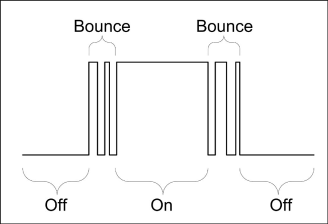
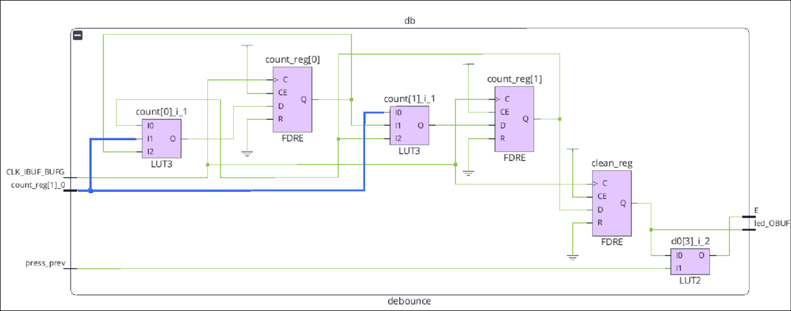
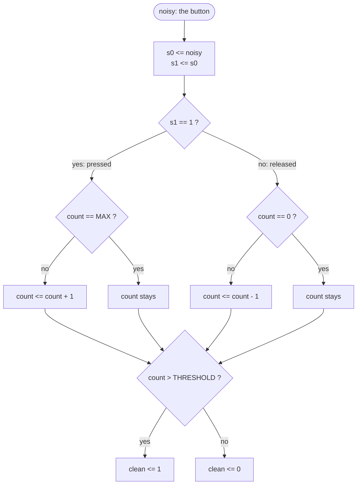

# COL215 – Digital Logic and System Design

**Lab 5: Debouncing a push button**

---

## 1. Introduction

A push button does not go cleanly from 0 to 1. For a few milliseconds, its metal
contacts **bounce** between 0 and 1 during one button press.



In this lab we will build a **debouncer**: a circuit that turns the bouncy
button's `noisy` signal into a `clean` one, that changes exactly once per press
and once per release. We will build it in four steps. Each step fixes a problem
that we observe on the board, and each step brings out the next problem:

| Step  | Idea         | Problem it fixes                                |
| :---: | ------------ | ----------------------------------------------- |
|   0   | no debouncer | –                                               |
|   1   | threshold    | one press counts several times                  |
|   2   | count down   | A very short release can create multiple counts |
|   3   | maximum      | Under count                                     |
|   4   | synchronizer | counter sometimes freezes for seconds           |

---

## 2. The board

| Input / Output | Meaning                                         |
| -------------- | ----------------------------------------------- |
| BTNC           | the button to debounce (`noisy`)                |
| BTNU           | clear the count                                 |
| LD15           | the noisy button as it is, no debouncing        |
| LD0            | `clean`, the debounced button                   |
| 7-segment      | number of presses: each 0 → 1 change of `clean` |

The 7-segment counter runs on the 100 MHz clock.

### Provided files

| File              | Status              | Description                                   |
| ----------------- | ------------------- | --------------------------------------------- |
| `debounce.v`      | **TODO, steps 1–4** | The debouncer                                 |
| `debounce_top.v`  | Given               | Board wrapper: debouncer, LEDs, counter       |
| `press_display.v` | Given               | Button press counter on the 7-segment display |
| `ssd.v`           | Given               | 7-segment decoder                             |
| `debounce.xdc`    | Given               | Basys3 constraints                            |
| `tb_debounce.v`   | Given               | Self-checking testbench for `debounce`        |

Do not change module names, port lists, or parameters.

Make a Vivado project for the Basys3 board (`xc7a35tcpg236-1`) with
`debounce_top.v`, `debounce.v`, `press_display.v` and `ssd.v` as design sources,
`debounce.xdc` as the constraint file, and `tb_debounce.v` as a simulation
source. `debounce_top` is the top module.

### The debouncer

```verilog
module debounce #(
    parameter THRESHOLD = 100_000,    // 1 ms at 100 MHz
    parameter MAX       = 2**21 - 1   // about 21 ms at 100 MHz
)(
    input      clk,      // 100 MHz
    input      noisy,    // the button
    output reg clean = 1'b0
);
    reg [31:0] count = 0;
```

### After every step

1. **Simulate** `tb_debounce.v` (*Set as Top*, *Run Behavioral Simulation*).
   It sets `THRESHOLD` to 5 and `MAX` to 20 so the test is short. Each step
   says which tests should pass.
2. **Program the board** and do the experiment of that step.

---

## 3. Step 0: see the bouncing

`debounce.v` starts with a placeholder, `clean <= noisy;`, so there is no
debouncing yet.

1. Generate the bitstream and program the board.
2. Press BTNU. The display shows `0`.
3. Press and release BTNC **once**, slowly. Look at the display.
4. Do you notice any discrepency?

The count often goes up by more than 1 for one BTNC press, sometimes also when
you **release** the button. Each extra count is a bounce.

---

## 4. Step 1: a threshold

### Problem:
During one button press, the button shows multiple 0 → 1 transitions.

### Solution:
A bounce is short. So only believe that the button is pressed when it has been 1
for a while (1ms). So we need to count how long the button has been pressed. If
it is more than the threshold, then we consider it as pressed otherwise, we ignore it.

**TODO 1.** Delete the placeholder. On every rising edge of `clk`:

- If `noisy` is 1, add 1 to `count`.
- If `noisy` is 0, set `count` to 0.
- Set `clean` to 1 if `count` is greater than `THRESHOLD`, and to 0
  otherwise.

**Simulate.** Tests 1, 2, 3 and 5 pass. **Test 4 fails**: a short 0 while
the button is held makes `clean` go 0 and back to 1.

**Board.**

1. Press BTNC 20 times. The count should now go up by 1 per press.
2. Press BTNU. 
3. Now press BTNC and **keep holding it** for a few seconds.
   Press lightly, or rock your finger a little. Watch the count.

---

## 5. Step 2: count down

### Problem:
Look at the LD15. A very short 0 caused by slightly lifting up the button resets
the count. So even though we have not fully released the button, the SSD display
shows the counter increasing.

### Solution:
A short 0 should not throw away the whole press. Instead of starting over,
**count down** while the button is 0. A short drop then only takes a little
off `count`.

**TODO 2.** Change the `noisy = 0` case:

- If `noisy` is 0, subtract 1 from `count`. 
- If `count` is already 0, leave it.

**Simulate.** Tests 1 to 4 pass. **Test 5 fails**: after a long press,
`clean` takes too long to go back to 0.

**Board.**

1. Repeat the holding experiment of step 1. No more extra counts.
2. Now press BTNC and hold it for about **5 seconds**. Release it and watch
   LD15 and LD0.
3. Hold it for 5 seconds again. Release it and, while LD0 is still on, press
   it again quickly.

LD15 goes off when you release, but LD0 stays on for about as long as you
held the button. A quick press during that time is not counted. While you
held the button, `count` went up to about 500 000 000 (5 s × 100 MHz), and
it has to count all the way back down to `THRESHOLD`.

---

## 6. Step 3: a maximum

### Problem
Step 2 created a new problem. If the button has been pressed for a long time, it
has to be released for the same long time for it to be considered released.

### Solution
There is no need to remember more than a few milliseconds of "pressed".
Stop counting up at `MAX` (about 21 ms). Then, however long the button was
held, a release takes at most about 20 ms to show.

**TODO 3.** Change the `noisy = 1` case:

- If `noisy` is 1, add 1 to `count`, but **not above `MAX`**: if `count`
  is already `MAX`, leave it.

**Simulate.** All 5 tests pass.

**Board.**

1. Hold BTNC for 5 seconds and release it. LD0 now goes off together with
   LD15.
2. Press BTNU. 
3. Now **tap BTNC quickly, many times**, for about a minute.
   Watch the count while you tap.


---

## 7. Step 4: a synchronizer

### Problem
Every tap should count. But you may see the counter **freeze**: taps are not
counted for many seconds, and then it might work again. It does not happen
often, so keep tapping. This is a *Mealy glitch*.

The problem is that `noisy` comes from outside the FPGA. It can change at any
time, for example, at a rising edge of `clk`.

The next value of `count` comes from logic (an adder) that takes `count` and
`noisy` as inputs. When `noisy` changes, that logic needs a few nanoseconds to
settle on its new result. If `noisy` changes just before a clock edge, the 32
flip-flops of `count` catch the logic **halfway**, while it is still changing.
`count` can then get a value that is neither `count + 1` nor `count - 1`.

Because of this, `count` can become **far above `MAX`**. The "stop at `MAX`
check never matches there, and when you let go, `count` has to count down from
up to 2³² − 1: about **43 seconds** at 100 MHz. That is the freeze.




## Solution
The fix: do not let the rest of the circuit look at `noisy` directly. First
copy it through **two flip-flops**, and use only the copy:

```verilog
reg s0 = 1'b0, s1 = 1'b0;   // put this next to count
```

**TODO 4.**

- On every rising edge of `clk`: `s0 <= noisy; s1 <= s0;`
- Use `s1` instead of `noisy` everywhere else.

The first flip-flop, `s0`, takes the risk of `noisy` changing at the clock edge.
It may need a little time to decide between 0 and 1, and the second flip-flop
gives it a whole clock cycle to do so.  `s1` only changes right after a clock
edge, so the logic that computes the next `count` has a whole clock cycle to
settle before the next edge. 

**Simulate.** All 5 tests still pass. The testbench cannot show this
problem: in simulation every flip-flop sees `noisy` change at the same
instant. Only real wires have different delays.

**Board.** Repeat the tapping experiment of step 3. The counter no longer
freezes.

Your finished debouncer:



We will build upon `debounce.v` in the next lab.

---

## 8. Summary

| Step  | Change                         | `tb_debounce` | What you see on the board                      |
| :---: | ------------------------------ | :-----------: | ---------------------------------------------- |
|   0   | `clean <= noisy`               |    1 of 5     | one press counts several times                 |
|   1   | count while 1, start over at 0 |    4 of 5     | a short drop while held counts again           |
|   2   | count down at 0, stop at 0     |    4 of 5     | `clean` stays 1 as long as the button was held |
|   3   | stop at `MAX`                  |    5 of 5     | the counter sometimes freezes for seconds      |
|   4   | two-flip-flop synchronizer     |    5 of 5     | one count per press                            |

---

### Things to ponder

Work through these on paper.

1. In step 0, why does the count sometimes go up when you **release** the
   button?
2. In step 2, what happens if you forget "not below 0"? Look at `count`
   right after the board is programmed, when the button is not pressed.
   What do LD0 and the display do?
3. What goes wrong if `THRESHOLD` is 100 (1 µs)? What goes wrong if `MAX` is
   100 000 000 (1 s)?
4. Why does step 3's freeze need `count` to be **wider** than `MAX`? The
   original version of this debouncer used a 21-bit `count` with
   `MAX = 2**21 - 1`. How long could the freeze last then?
5. Why do we use two flip-flops in the synchronizer, and not one?
