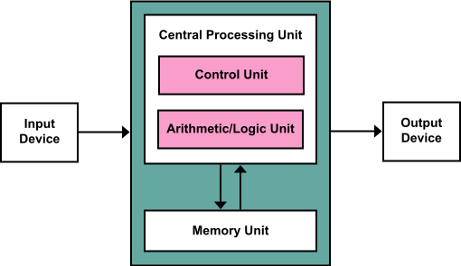
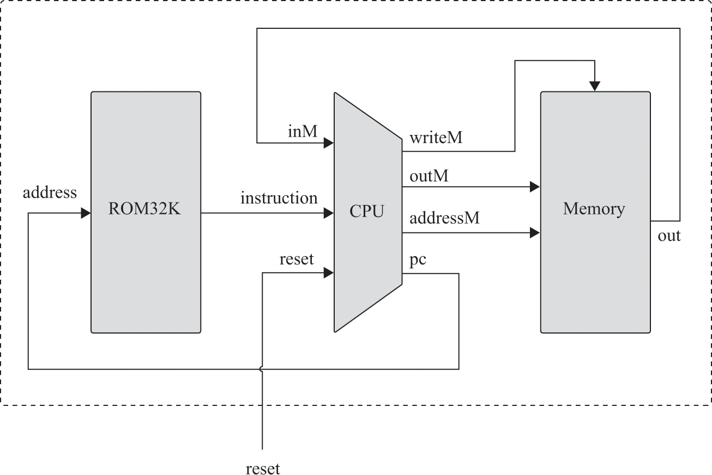
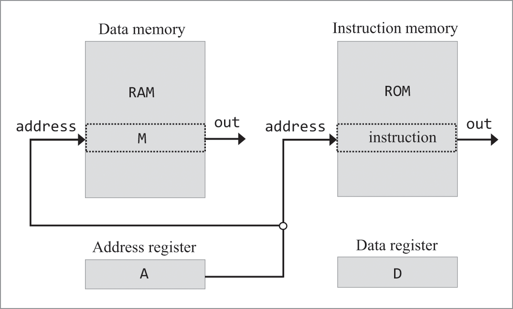
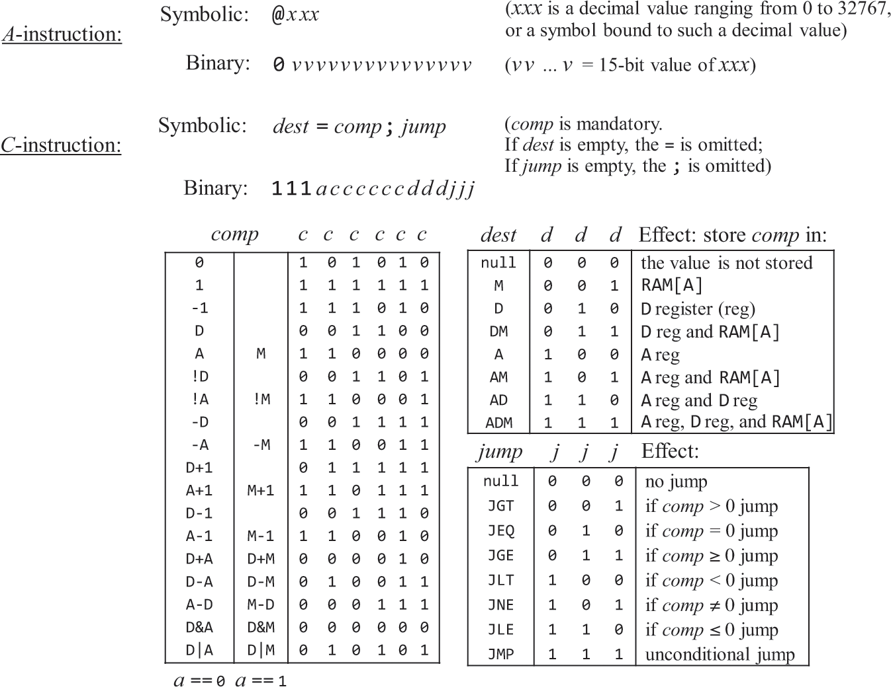
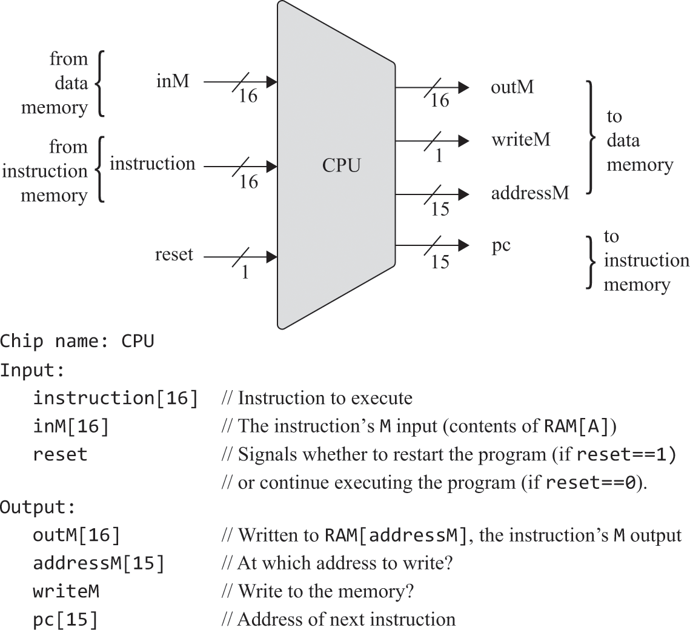
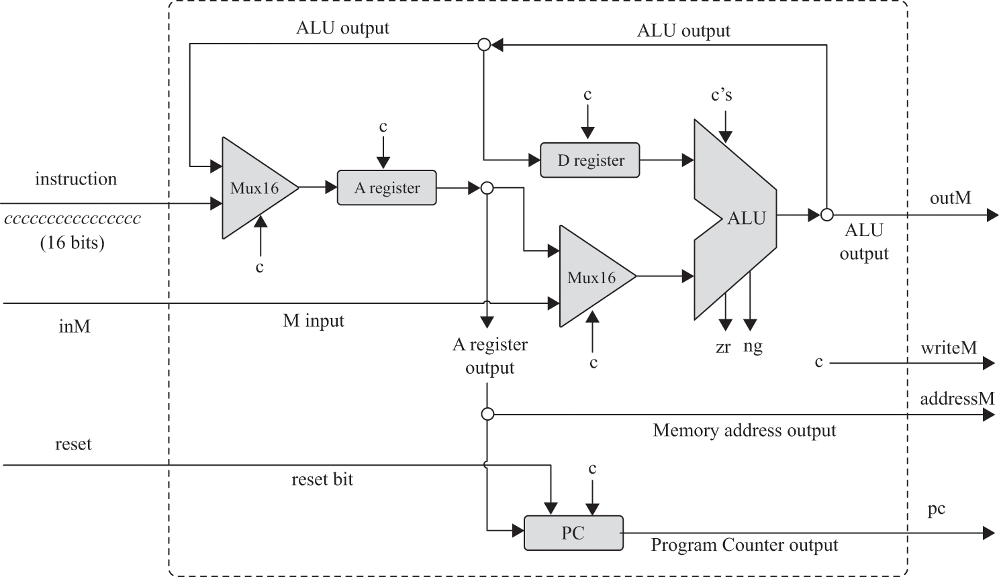

# Building a Computer
[Click Me To Download this folder all-at-once](https://download-directory.github.io/?url=https%3A%2F%2Fgithub.com%2Fcodenet%2Fcol215-digital-logic%2Ftree%2Fmain%2Flabs%2F07)

In this lab we will build a computer on the Basys3 board.

Modern computers follow the von Neumann architecture, shown below:



It has a CPU, which does the computation, and a memory unit, where both the
program and the data live.

At a high level, the CPU reads an instruction from memory to know what to
execute. The control unit then works out how to use the ALU to execute the
instruction, and the result is stored back in memory.

## Our Computer: Hack

We will call our computer the Hack computer. It also follows the von Neumann
architecture, but it is much simpler than our laptops and desktops, which are
x86 or ARM machines.

> **Question 1:** What is the architecture of your desktop?

It is simpler in the following ways:

1. It has two separate memories (see the figure below):
   1. ROM (`ROM32K`), which stores the program that it executes.
   2. RAM (`Memory`), which stores the data that the program uses while it
      runs.

   In most modern systems, the program and the data live in the same memory.

2. It uses a simpler instruction set, the Hack instruction set, instead of the
   more complicated x86 and ARM instruction sets.

The figure below shows the high-level design of the Hack computer. The CPU
reads instructions from the ROM at address `pc`, and reads and writes data in
the RAM at address `addressM`.



## Hack's Language: the Hack instruction set

To get our computer to do anything meaningful, we need a way to tell it what
to do. An instruction set is the "set" of instructions that the computer
understands. A computer only understands 0s and 1s, so every instruction is
also a bit string. In Hack, every instruction is exactly 16 bits.

Before diving into instructions, let's talk about the registers in the Hack CPU.

### Registers

Registers are used by the CPU to store intermediate values during execution.
Why not use the memory? Memory access is much slower than the CPU, so we can
drastically improve the performance of the computer by keeping a few registers
inside the CPU.

The Hack CPU has two registers:

| Name | What it is                                                                 |
|------|----------------------------------------------------------------------------|
| `D`  | Data register: holds a 16-bit value.                                       |
| `A`  | Address register: holds a 16-bit value, which can also be used as an address. |



Depending on the context, `A` points either into the RAM or into the ROM. We
could add more registers, for example separate `A` registers for the RAM and
the ROM, but we want to keep the number of registers small by reusing the same
register for different purposes as much as possible (Why?).

> **Question 2:** What CPU is in your desktop, and how many registers does it
> have?

### Two kinds of instructions

Let's come back to the instructions. Hack has two types of instructions, shown
in the figure below (figure 4.5 in the book).



#### A-instruction: `@value`

```
Symbolic:  @value
Binary:    0vvvvvvvvvvvvvvv
```

The first bit is `0`. The other 15 bits are a non-negative number (0 to 32767).
Executing this instruction stores `value` in the `A` register. For example,
`@5`, or `0000000000000101` as a bit string, sets `A = 5`.

We will see below how the `A` register is used to read and write the RAM, and
to choose where to jump in the ROM.

#### C-instruction: `dest = comp ; jump`

```
Symbolic:  dest = comp ; jump
Binary:    1 1 1 a c c c c c c d d d j j j
```

The `C` in C-instruction stands for compute. These instructions do the actual
computation. A C-instruction says: compute `comp`, save the result in `dest`,
then, depending on the result, `jump` to some other instruction. So the
instruction has to say what to compute, where to put the result, and whether
to jump. `jump` is the most involved part; we will come to it below. For now,
know that if/else and loops are implemented using `jump`.

##### What to compute?

111**acccccc**dddjjj. We use `a` and the 6 `c`s to describe what to compute.
Recall from the ALU lab how 6 bits control what the ALU computes. We use the
same ALU here, so `c1`..`c6` are exactly the ALU control bits
`zx nx zy ny f no`. Also recall that the ALU has two inputs, so we also need
to decide where the inputs come from:

1. The 1st input is always the `D` register.
2. The 2nd input is decided by `a`: if it is 0, it is the `A` register,
   otherwise it is `RAM[A]`. What is `RAM[A]`? It is the value stored in the
   RAM at the address held in `A`. We write `M` as shorthand for `RAM[A]`.

The first table in the figure is the complete list of computations that can be
performed.

##### Where to put the output?

111acccccc**ddd**jjj. We use the 3 `d`s to describe where to put the output:
`d1` writes `A`, `d2` writes `D`, and `d3` writes `M`. Any combination is
allowed, including none, so the 2nd table lists all 8 possibilities. Note that
we never write anything to the ROM (it is read-only memory, after all).

##### Where to jump after?

111accccccddd**jjj**. To support conditionals (if/else) and loops (while/for),
we need jump instructions. For example, it is very common to write
`if (cond) { ... }`. To support this, we must first compute `cond`, and then,
depending on its value, either run the code inside the braces or jump past it
to some other part of the ROM.

The jump condition always compares the result of `comp` with 0: `j1` jumps if
it is `< 0`, `j2` if it is `= 0`, and `j3` if it is `> 0`. Combining them gives
the 8 kinds of jumps listed in the 3rd table of the figure, from `null` (never
jump) to `JMP` (always jump).

But where does it jump to? A jump goes to the ROM address held in `A`. So
before jumping, you first use an A-instruction to set `A`:

```
@100    // A = 100
D;JGT   // if D > 0, the next instruction is ROM[100]; otherwise ROM[PC + 1]
```

Since `A` holds the jump target, `M` in the same instruction would mean
`RAM[jump target]`, which is rarely what you want. So an instruction that may
jump should not use `M`.

> **Question 3:** Decode `1111110111011000` by hand. What does it do?

Writing programs as sequences of bit strings is how people programmed
computers in the 1940s. Fortunately, we are not in the 1940s, and we can use
an *assembler*. Every instruction has a symbolic form, such as `D=D+1`, which
we can write instead of `1110011111010000`. But the computer only understands
the binary form, so the assembler translates the symbolic form into bits. We
will use the nand2tetris assembler at
<https://nand2tetris.github.io/web-ide/asm>: paste your program in, and it
gives you one 16-bit instruction per line.

### Putting it together

Reading or writing memory always takes two instructions: an `@` to set `A`,
then a C-instruction that uses `M`. Here is a program that computes
`RAM[0] = 2 + 3`:

```
@2      // A = 2
D=A     // D = 2
@3      // A = 3
D=D+A   // D = 5
@0      // A = 0
M=D     // RAM[0] = 5
(END)
@END    // A = 6, the ROM address of the instruction after (END)
0;JMP   // jump to ROM[6], i.e. back to @END, forever
```

There is no "halt" instruction, so a program ends with an infinite loop.
`(END)` is a *label*, not an instruction: the assembler replaces `@END` with the
ROM address of the instruction that follows the label. This way you never have
to count instruction addresses yourself.

> **Question 4:** Assemble the program above with the web assembler, and
> understand how each bit string is assembled.

More example programs are in [`programs/`](./programs).


## Building the computer on FPGA board.
A computer is nothing but a electrical circuit, which means we can describe it
in verilog and program it on the FPGA Board.


We have given you some files and you are required to implement some.

### TODO 1: The computer
Read `computer.v`. Understand how it describes a computer, identify
RAM, ROM, CPU, and how they are wired together.

> Question 5: How much RAM does Hack have? How much RAM does your desktop have?
How much RAM did the computer have which NASA used to take man to the moon?

We can represent the module as a diagram below, understand the diagram
completely, ask what you dont understand.


### TODO 2: The CPU

Your job is to complete `cpu.v`, following the proposed implementation of the CPU in
figure 5.8. It has 3 registers (`A`, `D`, and `PC`(program counter)). It uses 2
Muxers, and an `ALU` which you already built in the previous lab. All the subcomponents are already given (`alu.v`, `mux2_16.v`).



### Why do we need 3 registers?
We already talked about `A` and `D` in the previous section. A computer doesn't
only execute a single instruction, it has to keep executing the instructions one
after the other. In order to know what to execute next we use `PC`. `PC` holds
the address to the instruction in ROM which will be executed next.

### Why do we need 2 mux?

1. The left mux: Note that the register `A` can either hold value coming from the instruction itself (in case of an `A-instruction`),
or it can store the output of the ALU. See the second table in [figure 4.5](./figures/fig4.5_instruction_set.png). The left multiplexer is used to make this decision. 
2. The right mux: As noted previously ALU's second input can come from either `A` or `M`; This multiplexer selects that.

### Why do we need the ALU?
Duh...

> **Question 6:** In the above figure, the output of the `A` register goes to three
> places. What are they, and why does each one need `A`?

> **Question 7:** An A-instruction can only hold a 15-bit value. How would you
> put `-1` in the `D` register? How would you put `-5`?

### Testing
Run the testbench `tb_cpu.v` to test your implementation.

## TODO 3: Run it on the board

Once your CPU passes the testbenches, program the computer on the board using Vivado:

1. Create a new RTL project for the Basys3 board (part `xc7a35tcpg236-1`).
2. Add these design sources: `top.v`, `hex_display.v`, `computer.v`,
   `cpu.v`, `alu.v`, `sixteen_bit_adder.v`, `full_adder.v`, `mux2_16.v` and
   `zero_negate.v`. **Leave "Copy sources into project" unticked** (see
   below).
3. Add `top.xdc` as the constraints file.
4. Make sure `top` is the top module, then click *Generate Bitstream*.
5. Open the *Hardware Manager* and program the board.

By default `./programs/Counter.hack` is loaded, see `./programs/Counter.asm`
to understand what it does.

`top.v` loads the program into the ROM from the file named by `ROM_FILE`.
Vivado looks for this file relative to the folder that contains
`computer.v`. If you copy the sources into the project, Vivado cannot find
the program, and builds a computer with an empty ROM: the board then shows
nothing. Vivado reports this only as a critical warning in the *Messages*
window:

```
CRITICAL WARNING: [Synth 8-4445] could not open $readmem data file 'programs/Counter.hack'
```

If the board shows nothing, check for this warning first.

### A slow clock

The board's clock runs at 100 MHz. At that speed, the counter would go
through all 65536 values about 400 times a second, and all you would see is
`8888`. So `top.v` divides the clock by 2^24, and the computer executes only
about 6 instructions per second. This way you can watch it run, one
instruction at a time.

### What the board shows

| Board        | Shows                                                         |
|--------------|---------------------------------------------------------------|
| LD14 .. LD0  | `pc` in binary: the address of the next instruction           |
| LD15         | the computer's clock                                          |
| 7-segment    | `RAM[32767]` in hexadecimal (see below)                       |
| BTNC         | reset: hold it until `pc` goes back to 0                      |

Watch the LEDs: `pc` goes through 2, 3, 4, 5, then jumps back to 2. That is
the loop.

### The display is memory mapped

How does a program show something on the display? Hack has no "print"
instruction. Instead, the display is *memory mapped*: it is given a RAM
address, 32767 (`111111111111111`, the last address), and whatever the
program writes to that address appears on the display. To the program, the
display is just another memory word. `computer.v` watches for writes to that
address:

```verilog
if (writeM) ram[addressM] <= outM;
if (writeM && addressM == SSD_ADDRESS) ssd <= outM;
```

The word is stored in the RAM as well, so a program can also read back what
is on the display. That is how `M=M+1` in the counter works.

To select the display, `A` must hold 32767. `Counter.asm` uses `A=-1`: this
sets `A` to `1111111111111111`, and `addressM` is the low 15 bits of `A`,
which are all 1.

Real computers talk to their devices (screen, keyboard, network card, ...) in
the same way. The full Hack computer maps its screen to RAM addresses 16384
onwards, and its keyboard to address 24576.

The display shows the 16-bit value as 4 hexadecimal digits, one digit for
every 4 bits (`hex_display.v`).

> **Question 8:** Why can't the program use `@-1` to select the display?
> Give another instruction, other than `A=-1`, that selects it.

> **Question 9:** The counter counts in hexadecimal. What comes after `0009`?
> After `00FF`? What happens after `FFFF`, and why?

### Running your own program

Write a program, assemble it with the web assembler, and save the `.hack`
file in `programs/`. Then set `ROM_FILE` in `top.v` to your file (for
example `"programs/MyProgram.hack"`), generate the bitstream again, and
program the board.

> **Question 10:** Change the counter to count down from 10 to 0, and then
> stop.
